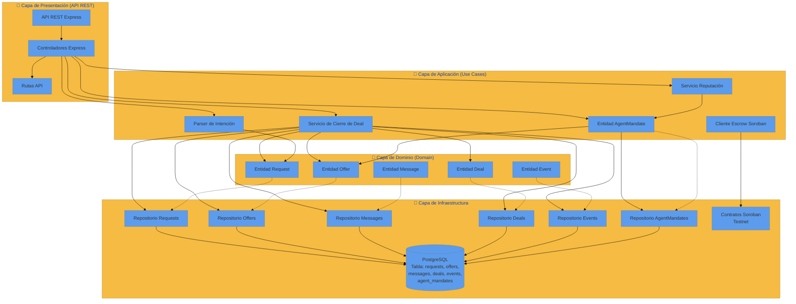
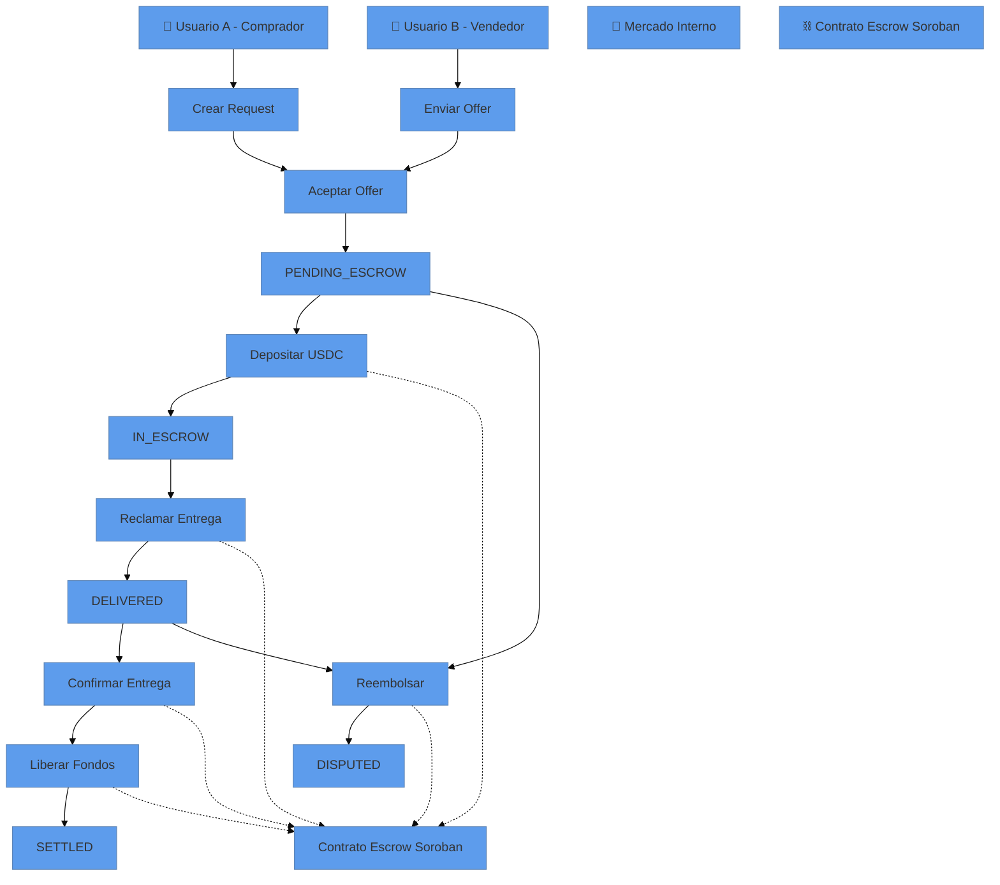
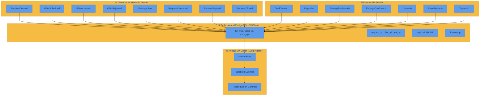

# ReWallet Lab - Mercado Interno (Fase 1)

[](https://nodejs.org/)
[](https://www.typescriptlang.org/)
[](https://www.postgresql.org/)
[](https://developers.stellar.org/)
[](https://opensource.org/licenses/MIT)

ReWallet Lab es un laboratorio de agentes autónomos para comercio electrónico descentralizado. Implementa un mercado interno de solicitudes (RFQ - Request for Quotation) donde compradores y vendedores negocian productos mediante agentes autónomos, con soporte para escrow on-chain en Stellar Soroban y trazabilidad completa de eventos.

## 📋 Tabla de Contenidos

- [🎯 Objetivo del Proyecto](#-objetivo-del-proyecto)
- [🏗️ Arquitectura](#-arquitectura)
- [📊 Diagrama de Arquitectura Hexagonal](#-diagrama-de-arquitectura-hexagonal)
- [🔄 Flujo de Transacciones del Deal](#-flujo-de-transacciones-del-deal)
- [📊 Capas del Sistema](#-capas-del-sistema)
- [📋 Diagrama de Eventos y Trazabilidad](#-diagrama-de-eventos-y-trazabilidad)
- [🚀 Despliegue del Sistema](#-despliegue-del-sistema)
- [🛠️ Instalación y Configuración](#-instalación-y-configuración)
- [📚 Endpoints de la API](#-endpoints-de-la-api)
- [🔗 Contratos Desplegados en Testnet](#-contratos-desplegados-en-testnet)
- [🧪 Pruebas E2E](#-pruebas-e2e)
- [📖 Documentación de Investigación](#-documentación-de-investigación)
- [🔗 Enlaces de Verificación](#-enlaces-de-verificación)
- [📄 Licencia](#-licencia)

---

## 🎯 Objetivo del Proyecto

El objetivo de ReWallet Lab es validar un mercado interno de solicitudes donde:

1. **Usuarios** pueden expresar necesidades de compra en lenguaje natural
2. **Agentes autónomos** parsean el lenguaje natural a solicitudes estructuradas (Request)
3. **Mercado interno** permite que contrapartes envíen ofertas (Offer)
4. **Negociación híbrida** donde el agente filtra y sugiere, pero el humano aprueba el deal final
5. **Escrow on-chain** que retiene fondos hasta la liberación condicional
6. **Trazabilidad completa** de todos los eventos en base de datos off-chain y anclaje on-chain

---

## 🏗️ Arquitectura

El sistema sigue una **arquitectura hexagonal** (puertos y adaptadores) que separa claramente las responsabilidades:

```
┌─────────────────────────────────────────────────────────────────┐
│                    Capa de Presentación (API REST)              │
│                    ┌─────────────────────────────────┐          │
│                    │  Express.js - Controladores     │          │
│                    │  Rutas API - Validación         │          │
│                    └─────────────────────────────────┘          │
└─────────────────────────────────────────────────────────────────┘
                              ↓
┌─────────────────────────────────────────────────────────────────┐
│                    Capa de Aplicación (Use Cases)               │
│                    ┌─────────────────────────────────┐          │
│                    │  Cierre de Deal                 │          │
│                    │  Agente Mandato               │          │
│                    │  Parser de Intención          │          │
│                    │  Reputación                   │          │
│                    │  Cliente Escrow Soroban       │          │
│                    └─────────────────────────────────┘          │
└─────────────────────────────────────────────────────────────────┘
                              ↓
┌─────────────────────────────────────────────────────────────────┐
│                    Capa de Dominio (Domain)                     │
│                    ┌─────────────────────────────────┐          │
│                    │  Request / Offer / Deal         │          │
│                    │  Message / Event                │          │
│                    │  AgentMandate                 │          │
│                    └─────────────────────────────────┘          │
└─────────────────────────────────────────────────────────────────┘
                              ↓
┌─────────────────────────────────────────────────────────────────┐
│                    Capa de Infraestructura                      │
│                    ┌─────────────────────────────────┐          │
│                    │  Repositorios (PostgreSQL)      │          │
│                    │  Contratos Soroban (Testnet)    │          │
│                    └─────────────────────────────────┘          │
└─────────────────────────────────────────────────────────────────┘
```

### Capas del Sistema

| Capa | Nombre | Descripción |
|------|--------|-------------|
| **Capa 1** | Mercado Interno | Request, Offer, Message, Deal, Events (off-chain) |
| **Capa 2** | Escrow | Contrato Soroban para retención de fondos |
| **Capa 3** | AgentMandate | Límites y permisos del agente (off-chain) |
| **Capa 4** | Trazabilidad y Reputación | Eventos on-chain, Agent Registry, reputación |
| **Capa 5** | Canales Externos | ChatGPT/ACP, Nirium (futuro) |

---

## 📊 Diagrama de Arquitectura Hexagonal



---

## 🔄 Flujo de Transacciones del Deal



---

## 📋 Diagrama de Eventos y Trazabilidad



---

## 🚀 Despliegue del Sistema

### 1. Backend (Node.js + Express)

```bash
# Clonar el repositorio
git clone https://github.com/Re-Wallet/LabAGENT.git
cd LabAGENT

# Instalar dependencias
npm install

# Configurar variables de entorno
cp .env.example .env
# Editar .env con tus valores

# Compilar TypeScript
npx tsc

# Iniciar el servidor
node dist/index.js
```

### 2. Base de Datos PostgreSQL

```bash
# Crear base de datos y usuario
sudo -u postgres psql -c "CREATE USER labagent WITH PASSWORD 'labagent';"
sudo -u postgres psql -c "CREATE DATABASE labagent OWNER labagent;"

# Ejecutar migraciones (DDL en tests/setup.ts)
psql -h localhost -U labagent -d labagent -f tests/setup.ts
```

### 3. Contratos Soroban (Testnet)

```bash
# Construir contratos
cd contracts/escrow-deal
stellar contract build

cd ../event-anchor
stellar contract build

cd ../agent-registry
stellar contract build

# Desplegar en testnet
stellar contract deploy \
  --wasm target/wasm32v1-none/release/escrow_deal.wasm \
  --alias escrow_deal_v1 \
  --network testnet \
  --source TU_CUENTA \
  -- \
  --admin TU_PUBLIC_KEY \
  --usdc-sac TU_SAC_DE_USDC \
  --settle-grace-seconds 604800
```

---

## 🛠️ Instalación y Configuración

### Prerrequisitos

- Node.js 18+
- PostgreSQL 15+
- Stellar CLI (para contratos)
- Rust + cargo (para contratos Soroban)

### Variables de Entorno

Crear archivo `.env`:

```env
NODE_ENV=development
PORT=3000
DB_HOST=localhost
DB_PORT=5434
DB_USER=labagent
DB_PASSWORD=labagent
DB_NAME=labagent

AGENTE_ID=agente_negocio_1
NEGOCIO_ID=negocio_1
GASTO_MAX_POR_OPERACION=50000
GASTO_MAX_ACUMULADO=200000
GASTO_VENTANA_TIEMPO_DIAS=30
RANGO_PRECIO_MIN=1
RANGO_PRECIO_MAX=100000
PLAZO_MAX_ENTREGA_DIAS=7

SOROBAN_CONTRACT_ID=CBTW3FBMCPURBGUGUL3TKVKKNPDPBMPQGQMCK4VK2MAHJXU7NHNXGEAP
SOROBAN_SAC_ID=CBPYDMY3MU6CDAY2QVPUV735Q7IT5BEG33IDJEDZUBP4A5IXSOAAAA62
SOROBAN_ADMIN_SECRET_KEY=TU_SECRET_KEY
```

---

## 📚 Endpoints de la API

| Método | Ruta | Descripción |
|--------|------|-------------|
| `POST` | `/requests` | Crear solicitud (texto libre con confirmación, o estructura directa) |
| `GET` | `/requests` | Listar tablero (filtros: estado, categoria, agente_id, limit, offset) |
| `GET` | `/requests/:id` | Ver solicitud + sala (offers, messages, deal) |
| `POST` | `/requests/:id/messages` | Enviar mensaje u oferta (OFFER, COUNTER_OFFER, TEXT) |
| `POST` | `/requests/:id/offers/:offerId/accept` | Aceptar oferta → Deal en PENDING_ESCROW → Request CLOSED |
| `POST` | `/requests/:id/cancel` | Cancelar solicitud |
| `GET` | `/requests/:id/resumen-agente` | Resumen del agente del solicitante (filtro por AgentMandate) |
| `POST` | `/requests/:id/sincronizar-estado` | Sincronizar estado del Deal con payment link del Prototype |
| `GET` | `/reputacion/:agenteId` | Reputación básica off-chain por agente_id |
| `GET` | `/health` | Health check |

### Ejemplo: Crear Request

```bash
curl -s -X POST http://localhost:3000/requests \
  -H "Content-Type: application/json" \
  -d '{"texto": "necesito 10 kg de azúcar, hasta $1500/kg, para el viernes", "confirmado": true, "solicitante_id": "usuario_a", "agente_id": "agente_negocio_1", "producto": "azúcar", "cantidad": 10, "unidad": "kg", "precio_max": 1500}'
```

Respuesta:
```json
{
  "ok": true,
  "request": {
    "id": "uuid-generado",
    "solicitante_id": "usuario_a",
    "agente_id": "agente_negocio_1",
    "producto": "azúcar",
    "cantidad": "10",
    "unidad": "kg",
    "precio_max": "1500",
    "estado": "OPEN"
  }
}
```

### Ejemplo: Aceptar Oferta

```bash
curl -s -X POST "http://localhost:3000/requests/:id/offers/:offerId/accept" \
  -H "Content-Type: application/json" \
  -d '{"actor_id": "usuario_a"}'
```

Respuesta:
```json
{
  "ok": true,
  "mensaje": "Deal creado en PENDING_ESCROW. Aprobado por el humano.",
  "result": {
    "deal": {
      "id": "uuid-deal",
      "estado": "PENDING_ESCROW",
      "precio_final": 1500
    }
  }
}
```

---

## 🔗 Contratos Desplegados en Testnet

| Contrato | Dirección | Descripción |
|----------|-----------|-------------|
| **Escrow de Deal** | `CAR4Z3CHDEYMMR6J6XMOWHRTWA45YDFAGGQXR7O76HAKM3ERJG33M47D` | Retiene USDC en escrow hasta liberación |
| **Event Anchor** | `CAB57G6KNWEV24PSF6BBOW6IG4KMT4E2IOVSSFJGOFPFE4LY3YWDJEM5` | Anclaje de eventos off-chain con Merkle root |
| **Agent Registry** | `CDDFBJ6UBN76FH6Q5PDPAHGSGV32OS4GZ5SF7TYUVJBV2UUDQN7RHMUN` | Registro de agentes y reputación acumulable |

### Verificar Contratos en Stellar Testnet

- [Escrow en Stellar Testnet](https://stellar.expert/explorer/testnet/contract/CAR4Z3CHDEYMMR6J6XMOWHRTWA45YDFAGGQXR7O76HAKM3ERJG33M47D)
- [Event Anchor en Stellar Testnet](https://stellar.expert/explorer/testnet/contract/CAB57G6KNWEV24PSF6BBOW6IG4KMT4E2IOVSSFJGOFPFE4LY3YWDJEM5)
- [Agent Registry en Stellar Testnet](https://stellar.expert/explorer/testnet/contract/CDDFBJ6UBN76FH6Q5PDPAHGSGV32OS4GZ5SF7TYUVJBV2UUDQN7RHMUN)
- [USDC SAC en Stellar Testnet](https://stellar.expert/explorer/testnet/contract/CBPYDMY3MU6CDAY2QVPUV735Q7IT5BEG33IDJEDZUBP4A5IXSOAAAA62)

---

## 🧪 Pruebas E2E

### Ejecutar todos los tests

```bash
npm test
```

### Ejecutar tests específicos

```bash
npx jest tests/e2e-mercado-interno.test.ts --verbose
```

### Casos de Prueba

| Test | Descripción | Estado |
|------|-------------|--------|
| Parser convierte texto a Request estructurado | ✅ Pasa |
| Parser falla limpiamente sin cantidad | ✅ Pasa |
| Parser falla limpiamente en saludo | ✅ Pasa |
| POST /requests - crear request desde texto libre | ✅ Pasa |
| POST /requests - crear request confirmado | ✅ Pasa |
| GET /requests - listar tablero | ✅ Pasa |
| POST /messages - Usuario B envía Offer | ✅ Pasa |
| GET /requests/:id - ver solicitud + sala | ✅ Pasa |
| GET /resumen-agente - agente filtra ofertas | ✅ Pasa |
| POST /accept - Usuario A acepta → Deal PENDING_ESCROW | ✅ Pasa |
| Verificar eventos emitidos | ✅ Pasa |
| Deal está en PENDING_ESCROW | ✅ Pasa |
| Inmutabilidad de Message | ✅ Pasa |
| GET /reputacion/:agenteId | ✅ Pasa |
| Agente sin actividad devuelve ceros | ✅ Pasa |
| Wallet mapping: guardar y obtener | ✅ Pasa |
| Deal payment link: guardar y obtener | ✅ Pasa |

---

## 🔗 Enlaces de Verificación

### Enlaces Externos

- [Stellar Testnet Explorer](https://stellar.expert/explorer/testnet)
- [Stellar Lab](https://lab.stellar.org/)
- [Documentación Soroban](https://developers.stellar.org/docs/build/smart-contracts/overview)
- [CAP-0046-08 - Smart Contract Logging](https://github.com/stellar/stellar-protocol/blob/master/core/cap-0046.md)

### Enlaces Internos

- [Research Mercado Interno](./RESEARCH_MERCADO_INTERNO.md)
- [Research Capa 2 - Escrow](./RESEARCH_CAPA2_ESCROW_SOROBAN.md)
- [Research Cogladius (evaluado y descartado)](./RESEARCH_CAPA2_COGLADIUS_ESCROW.md)
- [Research Capa 4 - Trazabilidad y Reputación](./RESEARCH_CAPA4_TRAZABILIDAD_REPUTACION.md)
- [Research Opción C - Mandate Gobernado](./RESEARCH_OPCION_C_MANDATE_GOBERNADO.md)
- [Diseño de Contratos Capa 2](./docs/architecture/diagrams/)

---

## 📦 Estructura del Proyecto

```
LabAGENT/
├── src/
│   ├── config/          # Configuración DB y entorno
│   ├── controllers/     # Controladores Express
│   ├── events/          # Servicio de eventos
│   ├── parser/          # Parser con reglas (no LLM)
│   ├── repositories/    # Repositorios de BD
│   ├── routes/          # Rutas de la API
│   ├── services/        # Servicios de negocio
│   │   ├── deal-closure.service.ts
│   │   ├── reputacion.service.ts
    │   ├── escrow-client.service.ts
│   │   └── agent-mandate.service.ts
│   └── index.ts         # Punto de entrada
├── tests/               # Tests E2E
├── contracts/           # Contratos Soroban
│   ├── escrow-deal/
│   ├── event-anchor/
│   └── agent-registry/
├── docs/                # Documentación y diagramas
│   └── architecture/diagrams/
├── scripts/             # Scripts de utilidad
├── RESEARCH_*.md        # Documentos de investigación
├── README.md            # Este archivo
├── docker-compose.yml   # Postgres para desarrollo
└── jest.config.js       # Configuración de Jest
```

---

## 📄 Licencia

Este proyecto está bajo la Licencia MIT. Ver el archivo `LICENSE` para más detalles.

---

## 🤝 Contribuir

1. Fork el repositorio
2. Crea una rama para tu feature (`git checkout -b feature/nueva-funcionalidad`)
3. Commit tus cambios (`git commit -am 'Añadir nueva funcionalidad'`)
4. Push a la rama (`git push origin feature/nueva-funcionalidad`)
5. Abre un Pull Request

---

**Desarrollado con ❤️ para el laboratorio ReWallet**
