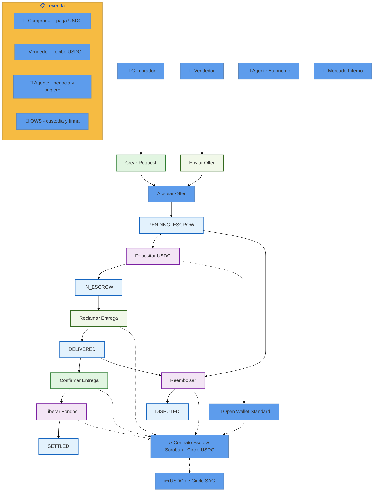
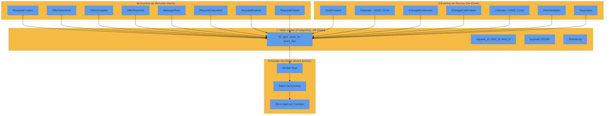

# ReWallet Lab - Mercado Interno (Fase 1)

[](https://nodejs.org/)
[](https://www.typescriptlang.org/)
[](https://www.postgresql.org/)
[](https://developers.stellar.org/)
[](https://openwallet.sh/)
[](https://opensource.org/licenses/MIT)

ReWallet Lab es un laboratorio de **agentes autónomos para comercio electrónico descentralizado**. Implementa un mercado interno de solicitudes (RFQ - Request for Quotation) donde compradores y vendedores negocian productos mediante agentes autónomos, con custodia y firmado de transacciones vía **Open Wallet Standard (OWS)** y custodia on-chain en **Stellar Soroban Testnet** con soporte para **USDC de Circle**.

---

## 📋 Tabla de Contenidos

- [🎯 Misión del Proyecto](#-misión-del-proyecto)
- [📜 Evolución del Proyecto](#-evolución-del-proyecto)
- [🏗️ Arquitectura](#-arquitectura)
- [📊 Diagrama de Flujo del Deal con OWS y Circle USDC](#-diagrama-de-flujo-del-deal-con-ows-y-circle-usdc)
- [📊 Diagrama de Eventos y Trazabilidad](#-diagrama-de-eventos-y-trazabilidad)
- [🚀 Despliegue del Sistema](#-despliegue-del-sistema)
- [🛠️ Instalación y Configuración](#-instalación-y-configuración)
- [📚 Endpoints de la API](#-endpoints-de-la-api)
- [🔗 Contratos Desplegados en Testnet](#-contratos-desplegados-en-testnet)
- [💸 Transacciones Reales Ejecutadas](#-transacciones-reales-ejecutadas)
- [🧪 Pruebas E2E](#-pruebas-e2e)
- [📖 Documentación de Investigación](#-documentación-de-investigación)
- [🔗 Enlaces de Verificación](#-enlaces-de-verificación)
- [📦 Estructura del Proyecto](#-estructura-del-proyecto)
- [📄 Licencia](#-licencia)
- [🤝 Contribuir](#-contribuir)

---

## 🎯 Misión del Proyecto

**ReWallet Lab** tiene como misión validar un mercado interno de solicitudes (RFQ) descentralizado donde compradores y vendedores pueden negociar productos mediante **agentes autónomos**, con custodia segura de fondos y firmado de transacciones sin exponer claves privadas.

### Objetivos específicos

| # | Objetivo | Descripción |
|---|----------|-------------|
| 1 | **Expresar necesidades en lenguaje natural** | Los usuarios escriben lo que quieren comprar y un agente lo convierte en una solicitud estructurada (`Request`) |
| 2 | **Ofertas de contrapartes** | Otros usuarios o agentes responden con `Offer` |
| 3 | **Negociación híbrida** | El agente filtra y sugiere, pero el humano aprueba el deal final |
| 4 | **Escrow on-chain con custodia segura** | Los fondos se retienen en un contrato Soroban hasta que se cumple la entrega y se libera condicionalmente, con firmado vía Open Wallet Standard (OWS) |
| 5 | **Claves privadas nunca expuestas** | OWS gestiona las claves cifradas en reposo y aplica políticas antes de firmar; el agente nunca toca la clave privada |
| 6 | **Trazabilidad completa** | Todos los eventos quedan en PostgreSQL (off-chain) con anclaje on-chain |
| 7 | **Soporte USDC de Circle** | El nuevo contrato de escrow usa el SAC de USDC de Circle en Stellar testnet |

---

## 📖 Historia de Usuario: Un Mercado Automatizado por IA

> *"Necesito comprar 500 kg de harina para mi panadería, pero no tengo tiempo de llamar a proveedores, comparar precios ni negociar. Quiero que alguien lo haga por mí, de forma segura y transparente."*

### María, dueña de una panadería local

María tiene una pequeña panadería. Cada semana necesita insumos: harina, azúcar, levadura, empaques. Antes, pasaba horas por teléfono pidiendo cotizaciones a diferentes proveedores, comparando precios y condiciones de entrega. A veces se olvidaba de comparar un proveedor y terminaba pagando de más.

Un día, María descubre **ReWallet Lab**.

### Paso 1: María expresa su necesidad

María no necesita saber escribir contratos inteligentes ni saber de blockchain. Simplemente escribe en el panel de ReWallet:

> *"Necesito 500 kg de harina de trigo, hasta $2.500/kg, entrega el viernes en mi panadería del centro, pago contra entrega."*

### Paso 2: El agente autónomo parsea la intención

El **Parser de Intención** de ReWallet convierte el lenguaje natural de María en una solicitud estructurada:

```
{
  producto: "harina de trigo",
  cantidad: 500,
  unidad: "kg",
  precio_max: 2500,
  plazo_entrega: "viernes",
  ubicacion: "centro",
  perfil: "pyme"
}
```

La solicitud se publica en el **Mercado Interno** como `Request` con estado `OPEN`.

### Paso 3: Los vendedores envían ofertas

Tres proveedores reciben la solicitud a través de sus propios agentes autónomos:

| Proveedor | Precio/kg | Total | Entrega | Condiciones |
|-----------|-----------|-------|---------|-------------|
| Proveedor A | $2.400 | $1.200.000 | Viernes | Contra entrega |
| Proveedor B | $2.300 | $1.150.000 | Sábado | Transferencia previa |
| Proveedor C | $2.450 | $1.225.000 | Viernes | 30 días de crédito |

### Paso 4: El agente filtra y recomienda

El **AgentMandate** de María evalúa cada oferta contra sus reglas:

- ✅ Gasto máximo por operación: $1.300.000 → Todas dentro
- ✅ Rango de precio: $2.000 - $2.600 → Todas dentro
- ✅ Whitelist de contrapartes: Proveedor A y C están autorizados, B no

El agente le muestra a María solo las dos mejores opciones dentro de su mandato:

> *"Te recomiendo al Proveedor A ($2.400/kg, entrega viernes) o al Proveedor C ($2.450/kg, 30 días de crédito). Ambas dentro de tu presupuesto y whitelist."*

### Paso 5: María aprueba el deal

María elige al **Proveedor A**. Clickea "Aceptar oferta". El sistema:

1. Crea un **Deal** en estado `PENDING_ESCROW`
2. Cierra el `Request` como `CLOSED`
3. Rechaza las demás ofertas automáticamente

### Paso 6: El escrow on-chain protege a ambos

María deposita **$1.200.000 en USDC de Circle** al contrato de escrow. El dinero queda retenido, no se lo lleva nadie aún.

El vendedor recibe la notificación de que los fondos están asegurados. Envía la harina el viernes.

María recibe la harina, verifica que está bien, y **confirma la entrega**.

Solo entonces, el contrato libera los **$1.200.000 al Proveedor A**.

### Paso 7: Todo queda trazable

Cada paso queda registrado:
- **Off-chain:** En PostgreSQL (quién aceptó, cuándo, precios)
- **On-chain:** En el contrato Soroban (depósito, liberación, eventos)

Si algo sale mal, María puede abrir una disputa y el sistema reembolsa los fondos.

### ¿Qué gana María?

| Antes | Después con ReWallet Lab |
|-------|-------------------------|
| Horas por teléfono comparando precios | Minutos escribiendo su necesidad |
| Riesgo de pagar sin recibir | Fondos en custodia hasta confirmar entrega |
| Sin registro claro de acuerdos | Trazabilidad completa off-chain y on-chain |
| Depender de la honestidad del vendedor | Contrato inteligente que solo libera si se confirma |

### El contexto de mañana

Imagina que mañana, cada vez que María cree una cuenta en su panadería, el sistema le pregunta: *"¿Tienes USDC, pesos locales o cripto para operar?"*. Ella elige USDC (stablecoin por el momento), se fondea, y el mercado de oferta y demanda se automatiza por IA: los agentes negocian por ella, ella solo aprueba el deal final, y el escrow on-chain garantiza que nadie se quede con el dinero sin entregar la mercadería.

---

## 📜 Evolución del Proyecto

### Fase 1 - Mercado Interno (completada)

| Versión | Cambio | Fecha | Estado |
|---------|--------|-------|--------|
| **v1.0** | Mercado interno base: Request/Offer/Deal, parser de intención, AgentMandate, reputación | Fase 1 | ✅ Completado |
| **v1.1** | Contrato escrow Soroban con USDC SAC | Fase 1 | ✅ Completado |
| **v1.2** | **Integración Open Wallet Standard (OWS)** - custodia y firmado con políticas | Fase 1 | ✅ Completado |
| **v1.3** | **Contrato escrow con USDC de Circle** - comprador paga su propio USDC | Fase 1 | ✅ Completado |

### Cambios principales

| Cambio | Descripción | Archivo |
|--------|-------------|---------|
| **OWS integración** | Reemplazo de `Keypair.fromSecret()` con claves en texto plano por `signAndSend` de OWS. Las claves se cifran en reposo en el vault de OWS. | `src/services/escrow-client.service.ts` |
| **AgentMandate + OWS** | `setupPolicy()` registra política ejecutable en OWS, importa clave admin al vault y crea API key vinculada | `src/services/escrow-client.service.ts` |
| **Contrato USDC Circle** | Nuevo contrato `escrow-deal-circle` con SAC de Circle (`CBIELTK6YBZJU5UP2WWQEUCYKLPU6AUNZ2BQ4WWFEIE3USCIHMXQDAMA`) y `comprador.require_auth()` | `contracts/escrow-deal-circle/` |
| **Comprador paga** | Modificado `depositar` para que el comprador pague su propio USDC al escrow (no el admin) | `contracts/escrow-deal-circle/src/lib.rs` |

---

## 🏗️ Arquitectura

El sistema sigue una **arquitectura hexagonal** (puertos y adaptadores) con OWS como capa de custodia y firmado entre la aplicación y la blockchain.

```
┌─────────────────────────────────────────────────────────────────────────────┐
│                    Capa de Presentación (API REST)                         │
│              Express.js - Controladores - Rutas API - Validación           │
└─────────────────────────────────────────────────────────────────────────────┘
                              ↓
┌─────────────────────────────────────────────────────────────────────────────┐
│                    Capa de Aplicación (Use Cases)                          │
│  Cierre de Deal · Agente Mandate · Parser de Intención · Reputación         │
│  EscrowClient (firma vía OWS)                                              │
└─────────────────────────────────────────────────────────────────────────────┘
                              ↓
┌─────────────────────────────────────────────────────────────────────────────┐
│                    Capa de Dominio (Domain)                                │
│  Request / Offer / Deal · Message / Event · AgentMandate                   │
└─────────────────────────────────────────────────────────────────────────────┘
                              ↓
┌─────────────────────────────────────────────────────────────────────────────┐
│              Capa de Custodia y Firmado - Open Wallet Standard (OWS)       │
│  Claves cifradas en reposo · Policy engine · Firmado sin exponer clave     │
│  Nunca expone la clave privada al agente ni al contexto del LLM            │
└─────────────────────────────────────────────────────────────────────────────┘
                              ↓
┌─────────────────────────────────────────────────────────────────────────────┐
│                    Capa de Infraestructura                                  │
│  Repositorios (PostgreSQL) · Contratos Soroban (Testnet)                    │
│  Escrow-deal · Escrow-deal-circle · Agent Registry · Event Anchor           │
└─────────────────────────────────────────────────────────────────────────────┘
```

### Capas del Sistema

| Capa | Nombre | Descripción |
|------|--------|-------------|
| **Capa 1** | Mercado Interno | Request, Offer, Message, Deal, Events (off-chain) |
| **Capa 2** | Escrow | Contrato Soroban para retención de fondos (USDC SAC) |
| **Capa 3** | AgentMandate | Límites y permisos del agente (off-chain) |
| **Capa 4** | Trazabilidad y Reputación | Eventos on-chain, Agent Registry, reputación |
| **Capa 5** | Canales Externos | ChatGPT/ACP, Nirium (futuro) |
| **OWS** | Open Wallet Standard | Custodia local, firmado con políticas, claves cifradas |

---

## 📊 Diagrama de Flujo del Deal con OWS y Circle USDC



---

## 📊 Diagrama de Eventos y Trazabilidad



---

## 🚀 Despliegue del Sistema

### 1. Contratos Desplegados en Stellar Testnet

| Contrato | Dirección | Descripción | Estado |
|----------|-----------|-------------|--------|
| **Escrow de Deal (original)** | `CAR4Z3CHDEYMMR6J6XMOWHRTWA45YDFAGGQXR7O76HAKM3ERJG33M47D` | Escrow con USDC SAC original | ✅ Desplegado |
| **Escrow de Deal - Circle USDC** | `CCRVOLUKWDAISVLAVGDYXWXAM5RAQPRW2AGLGJTXF24DAZNT7LOOBA7T` | Escrow con USDC de Circle, comprador paga | ✅ Desplegado |
| **Event Anchor** | `CAB57G6KNWEV24PSF6BBOW6IG4KMT4E2IOVSSFJGOFPFE4LY3YWDJEM5` | Anclaje de eventos off-chain | ✅ Desplegado |
| **Agent Registry** | `CDDFBJ6UBN76FH6Q5PDPAHGSGV32OS4GZ5SF7TYUVJBV2UUDQN7RHMUN` | Registro de agentes y reputación | ✅ Desplegado |
| **USDC SAC (Circle Testnet)** | `CBIELTK6YBZJU5UP2WWQEUCYKLPU6AUNZ2BQ4WWFEIE3USCIHMXQDAMA` | Stellar Asset Contract USDC de Circle | ✅ Externo |
| **USDC SAC (original)** | `CBPYDMY3MU6CDAY2QVPUV735Q7IT5BEG33IDJEDZUBP4A5IXSOAAAA62` | Stellar Asset Contract USDC original | ✅ Externo |

### 2. Backend (Node.js + Express)

```bash
# Clonar el repositorio
git clone https://github.com/Re-Wallet/LabAGENT.git
cd LabAGENT

# Instalar dependencias
npm install

# Configurar variables de entorno
cp .env.example .env
# Editar .env con tus valores

# Compilar TypeScript
npx tsc

# Iniciar el servidor
node dist/index.js
```

### 3. Base de Datos PostgreSQL

```bash
# Crear base de datos y usuario
sudo -u postgres psql -c "CREATE USER labagent WITH PASSWORD 'labagent';"
sudo -u postgres psql -c "CREATE DATABASE labagent OWNER labagent;"

# Ejecutar DDL (en tests/setup.ts)
psql -h localhost -U labagent -d labagent -f tests/setup.ts
```

### 4. Contratos Soroban (Testnet)

```bash
# Construir contratos
cd contracts/escrow-deal-circle
stellar contract build

# Desplegar en testnet (requiere cuenta con XLM y USDC de Circle)
stellar contract deploy \
  --wasm target/wasm32v1-none/release/escrow_deal_circle.wasm \
  --network testnet \
  --source-account TU_CUENTA \
  --network-passphrase "Test SDF Network ; September 2015" \
  --auto-sign \
  -- \
    --admin TU_PUBLIC_KEY \
    --usdc-sac CBIELTK6YBZJU5UP2WWQEUCYKLPU6AUNZ2BQ4WWFEIE3USCIHMXQDAMA \
    --settle_grace_seconds 604800
```

---

## 🛠️ Instalación y Configuración

### Prerrequisitos

- Node.js 18+
- PostgreSQL 15+
- Stellar CLI (para contratos)
- Rust + cargo (para contratos Soroban)

### Variables de Entorno

Crear archivo `.env`:

```env
NODE_ENV=development
PORT=3000

# Base de datos
DB_HOST=localhost
DB_PORT=5434
DB_USER=labagent
DB_PASSWORD=labagent
DB_NAME=labagent

# AgentMandate
AGENTE_ID=agente_negocio_1
NEGOCIO_ID=negocio_1
GASTO_MAX_POR_OPERACION=50000
GASTO_MAX_ACUMULADO=200000
GASTO_VENTANA_TIEMPO_DIAS=30
RANGO_PRECIO_MIN=1
RANGO_PRECIO_MAX=100000
PLAZO_MAX_ENTREGA_DIAS=7

# Escrow original
SOROBAN_CONTRACT_ID=CAR4Z3CHDEYMMR6J6XMOWHRTWA45YDFAGGQXR7O76HAKM3ERJG33M47D
SOROBAN_SAC_ID=CBPYDMY3MU6CDAY2QVPUV735Q7IT5BEG33IDJEDZUBP4A5IXSOAAAA62
SOROBAN_ADMIN_SECRET_KEY=TU_SECRET_KEY

# Escrow Circle USDC (nuevo)
SOROBAN_CIRCLE_CONTRACT_ID=CCRVOLUKWDAISVLAVGDYXWXAM5RAQPRW2AGLGJTXF24DAZNT7LOOBA7T
SOROBAN_CIRCLE_SAC_ID=CBIELTK6YBZJU5UP2WWQEUCYKLPU6AUNZ2BQ4WWFEIE3USCIHMXQDAMA
SOROBAN_CIRCLE_ADMIN_SECRET_KEY=TU_SECRET_KEY_ADMIN_CIRCLE

# Open Wallet Standard
OWS_VAULT_PATH=./.ows-vault
OWS_PASSPHRASE=TU_CONTRASEÑA_OWS
```

### Uso de OWS

El `EscrowClient` soporta firmado vía Open Wallet Standard:

```typescript
import { EscrowContractClient } from './src/services/escrow-client.service';
import { ESCROW_CIRCLE_TESTNET } from './src/services/escrow-client.service';

const client = new EscrowContractClient({
  ...ESCROW_CIRCLE_TESTNET,
  rpcUrl: 'https://soroban-testnet.stellar.org',
  networkPassphrase: 'Test SDF Network ; September 2015',
  adminSecretKey: process.env.SOROBAN_CIRCLE_ADMIN_SECRET_KEY || '',
  owsVaultPath: './.ows-vault',
  owsPassphrase: process.env.OWS_PASSPHRASE || '',
});

// Configurar política de AgentMandate en OWS (requerido para modo agent)
await client.setupPolicy('./.ows-mandate.json');

// Depositar (el comprador paga su propio USDC)
await client.depositar({
  comprador: 'GBDNESOTDON5ZY5MATJ544HIEJ4NQT3ZUMATCDTBMB2W56HJTUJLO2KW',
  vendedor: 'GBXXXXXXXXXXXXXXXXXXXXXXXXXXXXXXXXXXXXXXXXXXXXXX',
  monto: 10000000n, // 10 USDC (7 decimales)
});
```

---

## 📚 Endpoints de la API

| Método | Ruta | Descripción |
|--------|------|-------------|
| `POST` | `/requests` | Crear solicitud (texto libre o estructura directa) |
| `GET` | `/requests` | Listar tablero (filtros: estado, categoria, agente_id) |
| `GET` | `/requests/:id` | Ver solicitud + sala (offers, messages, deal) |
| `POST` | `/requests/:id/messages` | Enviar mensaje u oferta |
| `POST` | `/requests/:id/offers/:offerId/accept` | Aceptar oferta → Deal en PENDING_ESCROW |
| `POST` | `/requests/:id/cancel` | Cancelar solicitud |
| `GET` | `/requests/:id/resumen-agente` | Resumen del agente del solicitante (filtro por AgentMandate) |
| `POST` | `/requests/:id/sincronizar-estado` | Sincronizar estado del Deal |
| `GET` | `/reputacion/:agenteId` | Reputación básica off-chain por agente_id |
| `GET` | `/health` | Health check |

---

## 💸 Transacciones Reales Ejecutadas

A continuación se listan las transacciones reales ejecutadas en Stellar testnet durante el desarrollo:

### Despliegue de contratos

| Contrato | Transacción | Explorador |
|----------|-------------|------------|
| Escrow-deal (original) | - | [Ver en Stellar Expert](https://stellar.expert/explorer/testnet/contract/CAR4Z3CHDEYMMR6J6XMOWHRTWA45YDFAGGQXR7O76HAKM3ERJG33M47D) |
| **Escrow-deal-circle (Circle USDC)** | `bbd2998be75f5a00e43495c2ccca67584653e10ceb8202dadd143644137e08cf` | [Ver en Stellar Expert](https://stellar.expert/explorer/testnet/contract/CCRVOLUKWDAISVLAVGDYXWXAM5RAQPRW2AGLGJTXF24DAZNT7LOOBA7T) |

### Flujo E2E con USDC de Circle (Deal ID: 1)

| Paso | Acción | Transacción | Estado |
|------|--------|-------------|--------|
| 1 | **Depositar** - 10 USDC comprador→escrow | `d7ddffa8e1cc11659165a91353a538c5fab20181723f90c269c633096519bc93` | ✅ Éxito |
| 2 | **Reclamar entrega** - vendedor indica entrega | `92eee358cb28561ede7daf76d769c0ede14e60721e5a9e764e6515affc57e609` | ✅ Éxito |
| 3 | **Confirmar entrega** - comprador confirma recepción | `cd466552d56931707e3a0170c41bcbaa3d2253df6a00827eed1483610e52a49c` | ✅ Éxito |
| 4 | **Liberar fondos** - 10 USDC escrow→vendedor | `0718cd56e736cf2e8ee538e10a60623388ec43e665c6e0c43f75cfbd25ad4967` | ✅ Éxito |

### Ver en Stellar Expert

- [Contrato Escrow Circle USDC](https://stellar.expert/explorer/testnet/contract/CCRVOLUKWDAISVLAVGDYXWXAM5RAQPRW2AGLGJTXF24DAZNT7LOOBA7T)
- [USDC SAC Circle Testnet](https://stellar.expert/explorer/testnet/contract/CBIELTK6YBZJU5UP2WWQEUCYKLPU6AUNZ2BQ4WWFEIE3USCIHMXQDAMA)
- [Stellar Testnet Explorer](https://stellar.expert/explorer/testnet)

---

## 🧪 Pruebas E2E

### Ejecutar todos los tests

```bash
npm test
```

### Ejecutar tests específicos

```bash
npx jest tests/e2e-mercado-interno.test.ts --verbose
```

### Casos de Prueba

| Test | Descripción | Estado |
|------|-------------|--------|
| Parser convierte texto a Request estructurado | ✅ Pasa |
| Parser falla limpiamente sin cantidad | ✅ Pasa |
| Parser falla limpiamente en saludo | ✅ Pasa |
| POST /requests - crear request desde texto libre | ✅ Pasa |
| POST /requests - crear request confirmado | ✅ Pasa |
| GET /requests - listar tablero | ✅ Pasa |
| POST /messages - Usuario B envía Offer | ✅ Pasa |
| GET /requests/:id - ver solicitud + sala | ✅ Pasa |
| GET /resumen-agente - agente filtra ofertas | ✅ Pasa |
| POST /accept - Usuario A acepta → Deal PENDING_ESCROW | ✅ Pasa |
| Verificar eventos emitidos | ✅ Pasa |
| Deal está en PENDING_ESCROW | ✅ Pasa |
| Inmutabilidad de Message | ✅ Pasa |
| GET /reputacion/:agenteId | ✅ Pasa |
| Agente sin actividad devuelve ceros | ✅ Pasa |

---

## 📖 Documentación de Investigación

- [Research Mercado Interno](./RESEARCH_MERCADO_INTERNO.md)
- [Research Capa 2 - Escrow Soroban](./RESEARCH_CAPA2_ESCROW_SOROBAN.md)
- [Research Cogladius (evaluado y descartado)](./RESEARCH_CAPA2_COGLADIUS_ESCROW.md)
- [Research Capa 4 - Trazabilidad y Reputación](./RESEARCH_CAPA4_TRAZABILIDAD_REPUTACION.md)
- [Research Opción C - Mandate Gobernado](./RESEARCH_OPCION_C_MANDATE_GOBERNADO.md)
- [OWS - Open Wallet Standard Integration](./odd/tasks/ows-stellar-integration.md)

---

## 🔗 Enlaces de Verificación

### Enlaces Externos

- [Stellar Testnet Explorer](https://stellar.expert/explorer/testnet)
- [Stellar Lab](https://lab.stellar.org/)
- [Documentación Soroban](https://developers.stellar.org/docs/build/smart-contracts/overview)
- [Open Wallet Standard](https://openwallet.sh/)
- [USDC Contract Addresses (Circle)](https://developers.circle.com/stablecoins/usdc-contract-addresses)

### Enlaces Internos

Todos los archivos de investigación y diseño están en la raíz del proyecto con prefijo `RESEARCH_*` y `docs/`.

---

## 📦 Estructura del Proyecto

```
LabAGENT/
├── src/
│   ├── config/          # Configuración DB y entorno
│   ├── controllers/     # Controladores Express
│   ├── events/          # Servicio de eventos
│   ├── parser/          # Parser con reglas (no LLM)
│   ├── repositories/    # Repositorios de BD
│   ├── routes/          # Rutas de la API
│   ├── services/        # Servicios de negocio
│   │   ├── deal-closure.service.ts
│   │   ├── reputacion.service.ts
│   │   ├── escrow-client.service.ts   ← Firma vía OWS
│   │   └── agent-mandate.service.ts   ← Políticas de agente
│   └── index.ts         # Punto de entrada
├── tests/               # Tests E2E
├── contracts/           # Contratos Soroban
│   ├── escrow-deal/              ← Contrato original (USDC SAC original)
│   ├── escrow-deal-circle/       ← Contrato con USDC de Circle
│   │   ├── Cargo.toml
│   │   ├── src/lib.rs
│   │   └── target/wasm32v1-none/release/escrow_deal_circle.wasm
│   ├── event-anchor/
│   └── agent-registry/
├── docs/                # Documentación y diagramas
├── scripts/             # Scripts de utilidad
│   ├── create-usdc-*.js
│   └── ows-agent-mandate-policy.sh ← Política ejecutable para OWS
├── odd/                 # ODD (Organic Driven Development) tracking
│   └── tasks/ows-stellar-integration.md
├── vendor/ows-core/     ← OWS (Open Wallet Standard) - fork PR #181
├── node_modules/@open-wallet-standard/core/ ← Bindings de Node para OWS
├── RESEARCH_*.md        # Documentos de investigación
├── README.md            # Este archivo
├── docker-compose.yml   # Postgres para desarrollo
├── jest.config.js       # Configuración de Jest
└── tsconfig.json        # Configuración de TypeScript
```

---

## 📄 Licencia

Este proyecto está bajo la Licencia MIT. Ver el archivo `LICENSE` para más detalles.

---

## 🤝 Contribuir

1. Fork el repositorio
2. Crea una rama para tu feature (`git checkout -b feature/nueva-funcionalidad`)
3. Commit tus cambios (`git commit -am 'Añadir nueva funcionalidad'`)
4. Push a la rama (`git push origin feature/nueva-funcionalidad`)
5. Abre un Pull Request

---

**Desarrollado con ❤️ para el laboratorio ReWallet**
